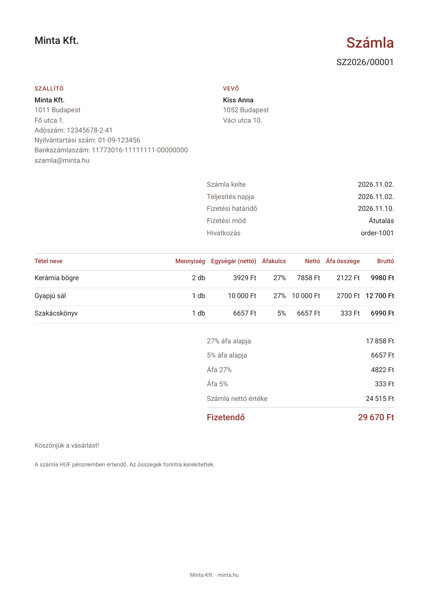

# szamlazo

[](https://github.com/wasabiprivaterelay/szamlazo/actions/workflows/ci.yml)
[](LICENSE)

Self-hosted invoicing for one Hungarian business: it issues invoices, reports
them to NAV Online Számla, emails them to the buyer, keeps them for eight
years, and tells you when something goes wrong. You run it on your own server
and talk to it over an HTTP API, from a web shop, a script, or a UI you build
on top.

It is what Számlázz.hu or Billingo do for invoices you issue from your own
systems, without a monthly fee and without your invoices living on someone
else's servers.

It began as the invoicing backend of a family web shop, where the NAV client
and the invoice code were first written and tested against NAV, and was split
out into its own project in November 2026.

```
your web shop / script / UI
        │  POST /v1/invoices   (API key)
        ▼
┌───────────────────────────────┐        ┌──────────────────────────┐
│ szamlazo server               │ ─────▶ │ NAV Online Számla (v3.0) │
│  • gapless numbering          │        └──────────────────────────┘
│  • PDF, SHA-256 fingerprinted │ ─────▶  Brevo: invoice to the buyer,
│  • checker: report, retry,    │         alerts to you, monthly archive
│    email, reconcile, archive  │ ─────▶  Healthchecks.io heartbeat
└──────┬──────────────┬─────────┘
       ▼              ▼
   Postgres     PDF storage (folder or S3 / Cloudflare R2)
```

<p align="center"></p>

## What it does

- **Issues invoices** with numbers like `SZ2026/00001` that never skip and
  never repeat, even under concurrent requests (one locked database row,
  consumed in the same transaction that stores the invoice).
- **Refuses to issue twice.** Send your order id as `reference`; a retry
  returns the invoice already issued instead of a second one.
- **Reports every invoice and storno to NAV** (Online Számla API v3.0),
  follows the submission until NAV accepts it, and asks NAV before ever
  resending, so a lost answer never becomes a duplicate report.
- **Checks company buyers' tax numbers with NAV** before issuing.
- **Every Hungarian VAT treatment a domestic sale needs:** 27, 18 and 5 %,
  tárgyi adómentes (TAM), alanyi adómentes sellers (AAM), out of scope (ÁKK)
  and domestic reverse charge (fordított adózás), each printed with its legal
  reference and reported to NAV the way the schema wants.
- **Renders the PDF** with every field Hungarian law requires, your logo and
  colour, and stores its SHA-256. A PDF that changes afterwards is never
  served and raises an alert.
- **Emails the invoice to the buyer** once NAV has accepted it, retrying
  failures, and never sending the same email twice.
- **Cannot be altered.** Invoices and the audit log are append-only at the
  database level: a trigger rejects every update and delete. A mistake is
  corrected with a storno, as the law requires.
- **Watches itself.** A checker inside the server raises an alert by email
  for anything it cannot settle within an hour (NAV down, an email bouncing),
  and resolves it when it clears. Every night it compares your invoices with
  NAV's records and re-checks every stored PDF.
- **Archives.** Each month's invoices (PDFs and NAV XML) are emailed as a zip
  to your accountant or an archive mailbox, and an encrypted off-site backup
  runs nightly.
- **Tax inspection export** in the format 23/2014. (VI. 30.) NGM rendelet
  asks for.

Everything is configured with environment variables; nothing in the code is
specific to any one business. The limits of this version (forints only,
Hungarian buyers, gross-priced lines) are listed in [docs/limits.md](docs/limits.md).

## Repository

| Path | What it is |
|---|---|
| [`packages/nav`](packages/nav) | `@szamlazo/nav`: a NAV Online Számla v3.0 client and command-line tool. Usable on its own. |
| [`packages/invoicing`](packages/invoicing) | `@szamlazo/invoicing`: amounts, numbering, storno and the PDF. No database, no network. Usable on its own. |
| [`packages/server`](packages/server) | The server: HTTP API, Postgres, storage, email, the checker. |
| [`deploy/`](deploy) | Production: Docker Compose with Postgres, the server and a Cloudflare Tunnel; the backup script. |
| [`docs/`](docs) | Guides: NAV test system, production, operations, API, security. |

## Quick start: running it on your computer

About ten minutes. You need **Node.js 22.9 or newer**, **Docker** (for
Postgres) and **git**. Nothing here talks to NAV yet; that is the next step.

**1. Get the code and its dependencies.**

```sh
git clone https://github.com/wasabiprivaterelay/szamlazo.git
cd szamlazo
npm ci
```

**2. Start Postgres.** This starts a database for the server and a second one
for the tests, reachable only from this computer.

```sh
docker compose up -d --wait
```

**3. Configure.** Copy the example settings. They work as they are for
trying it out; the seller is a made-up `Minta Kft.`

```sh
cp .env.example .env
```

**4. Make an API key.** The server accepts no request without one.

```sh
npm run szamlazo -- api-key new local
```

It prints two things. Keep the key (`szk_…`) for the requests below. Paste the
`local:…` line into `.env` as the value of `API_KEYS`:

```sh
API_KEYS=local:3f1c…            # the line it printed, not the key
```

**5. Start the server.**

```sh
npm run dev
```

It migrates the database and listens on `http://127.0.0.1:3000`. It warns that
NAV and email are not configured; that is expected for now.

**6. Issue an invoice.** In a second terminal, with your key:

```sh
export SZAMLAZO_KEY=szk_…      # the key from step 4

curl -s http://127.0.0.1:3000/v1/invoices \
  -H "Authorization: Bearer $SZAMLAZO_KEY" \
  -H "Content-Type: application/json" \
  -d '{
    "reference": "order-1001",
    "buyer": {
      "type": "private",
      "name": "Kiss Anna",
      "postcode": "1052",
      "city": "Budapest",
      "address": "Váci utca 10.",
      "email": "anna@example.com"
    },
    "lines": [
      { "description": "Kerámia bögre", "quantity": 2, "unit": "db", "unitPriceGross": 4990, "vatRate": 27 }
    ],
    "paymentMethod": "card"
  }'
```

The answer is the invoice, with `"invoiceNumber": "SZ2026/00001"` and its
totals worked out (gross 9 980, net 7 858, VAT 2 122). Send the same request
again: you get the same invoice back with `"alreadyIssued": true`, not a
second one.

**7. Get the PDF.** Use the `id` from the answer:

```sh
curl -s -o invoice.pdf -H "Authorization: Bearer $SZAMLAZO_KEY" \
  http://127.0.0.1:3000/v1/invoices/<id>/pdf
```

**8. Check that everything is sound.**

```sh
npm test                          # every package's tests; the server's use the test database
npm run szamlazo -- doctor        # every setting, checked
```

## Next steps

1. **Connect NAV's test system:** [docs/nav-test-environment.md](docs/nav-test-environment.md).
   Register, create a technical user, put five values in `.env`, and watch a
   test invoice go through NAV.
2. **Go to production:** [docs/production.md](docs/production.md). A VPS,
   Docker, Cloudflare Tunnel and Access, R2 for PDFs and backups, Brevo for
   email, Healthchecks.io for monitoring, and a go-live checklist.
3. **Integrate:** [docs/api.md](docs/api.md) has every endpoint, field and
   error code.
4. **Run it:** [docs/operations.md](docs/operations.md) covers alerts,
   correcting an invoice, exports, key rotation, upgrades and restores.

## Documentation

| | |
|---|---|
| [docs/nav-test-environment.md](docs/nav-test-environment.md) | NAV registration, technical user, test invoices, common NAV errors |
| [docs/production.md](docs/production.md) | From an empty VPS to live invoices, step by step |
| [docs/api.md](docs/api.md) | The HTTP API reference |
| [docs/operations.md](docs/operations.md) | Day-to-day running: alerts, storno, exports, backups, upgrades |
| [docs/security.md](docs/security.md) | Threat model, what protects what, and the audit of this version |
| [docs/limits.md](docs/limits.md) | What this version does not do, and the legal ground it stands on |
| [docs/ui.md](docs/ui.md) | How to build a UI on top, and how to secure it |
| [.env.example](.env.example) | Every setting, with where its value comes from |

## Development

```sh
npm run dev       # server with reload, from source
npm test          # all packages; the server's tests need `docker compose up -d`
npm run lint
npm run check     # TypeScript
npm run build     # libraries to dist/, server bundled to packages/server/dist
npm run nav -- check                 # the NAV command-line tool (packages/nav)
npm run szamlazo -- help             # the server's maintenance commands
```

The database schema is in `packages/server/src/db/schema.ts`. After changing
it, `npm run db:generate -w @szamlazo/server` writes the migration; the server
applies migrations at start-up. CI fails if the schema and the migrations
disagree.

## Disclaimer

This is software, not tax advice. It implements the NAV specification and the
invoicing rules as its authors understand them, and it has been used in
production, but you are responsible for your invoices. Have your accountant
look at a sample invoice before you go live. See [docs/limits.md](docs/limits.md).

## License

[MIT](LICENSE).
